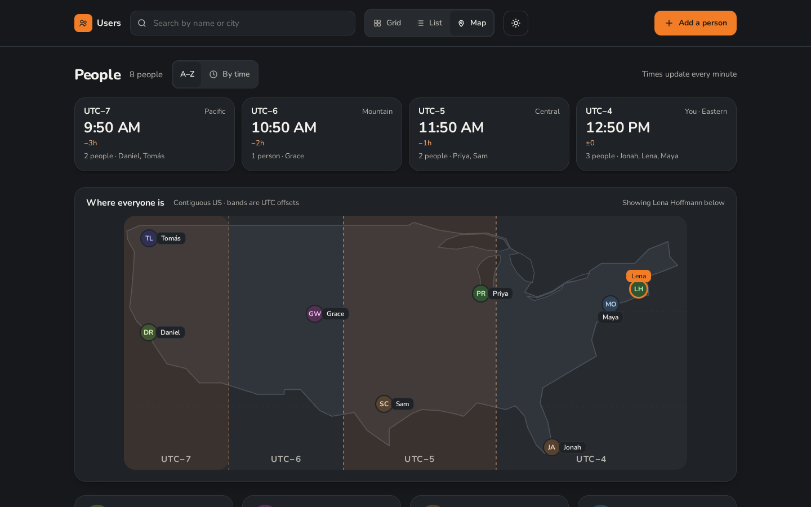
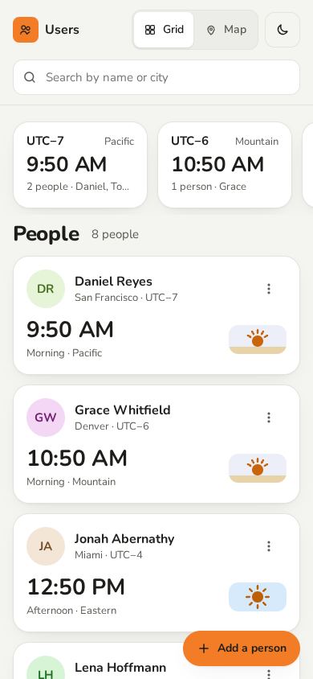

# User Management

A small app for a distributed team: a card for each person with their local time, and a strip that groups everyone by UTC offset. Adding someone takes a name and a US zip code; the city, coordinates and offset are looked up for you.

**Live:** https://user-management-plum-six.vercel.app (the real API on Vercel, with Upstash Redis and OpenWeatherMap)


<p>
  
  
</p>

`yarn screenshots` regenerates these from the running app, with the clock frozen at the time used in the Figma file.

## Getting started

```sh
yarn install
cp .env.example .env   # optional: the defaults run offline
yarn seed              # optional: adds the sample team
yarn dev               # API on :8080 and the app on http://localhost:5173
```

| Script | |
|---|---|
| `yarn dev` | API and client with reload; Vite proxies `/api` to the API |
| `yarn start` | API only |
| `yarn build` | production build of the client into `client/dist` |
| `yarn seed` | adds the eight sample people through the configured provider |
| `yarn storybook` | Storybook on http://localhost:6006, one story per Figma variant |
| `yarn test` | server and client suites |
| `yarn typecheck` | both workspaces |

## Server

A TypeScript Express API in `server/`.

- `server/src/core/`: the user record, the users service and the ports it depends on (`LocationProvider`, `UsersRepo`, `Clock`). Nothing in here knows about HTTP, files or any vendor.
- `server/src/storage/<name>/`: `UsersRepo` implementations (`memory`, `json-file`). Each one passes `storage/repo-contract.ts`.
- `server/src/http/`: routes, request validation and error responses.
- `server/src/providers/location/<name>/`: `LocationProvider` implementations, listed in `providers/location/index.ts`.
- `server/src/zips/`: the `ZipDirectory` that knows which US zips are real, read from `zips/us.json`.
- `server/src/app.ts`: `buildApp({ repo, locationProvider, zipDirectory, clock })` wires it together.
- `server/src/compose.ts`: picks the concrete storage and provider from the environment. It's the only file that does.
- `server/src/main.ts`: loads `.env` and starts the server. `api/index.ts` is the same app as a Vercel function.
- `product.json`: the product name. Code imports it, and a test fails if the README title or a package name drifts from it.

A user is `id, name, zip, city, lat, lon, utcOffsetSeconds, locationUpdatedAt, locationStatus`. A timezone is a UTC offset in seconds, captured when the location was looked up. Editing only looks the zip up again when it changes.

Zips are checked twice. `zips/us.json` (every real US zip from GeoNames, as a 12.5 KB bitmap that the client bundles too) says whether a zip exists; the location provider says where it is. `locationStatus` records the outcome:

| `locationStatus` | When | What happens |
|---|---|---|
| `located` | the provider placed the zip | city, coordinates and offset are filled in |
| `pending` | the provider was unreachable | saved anyway; the client retries every minute |
| `cantLocate` | the zip is real but the provider can't place it | saved and flagged on the card; retrying won't help |
| `invalidZip` | a later lookup finds the zip is no longer real | flagged on the card |

A zip that isn't real is refused outright, by the form and by the API (`400 invalid_zip`). Flagged people show a "Fix zip" banner, and a "needs attention" count above the grid filters to them. To rebuild the zip list, see `zips/README.md`. It contains data from GeoNames (www.geonames.org), licensed CC BY 4.0.

| Method | Path | |
|---|---|---|
| `GET` | `/api/users` | everyone, sorted by name |
| `POST` | `/api/users` | `{ name, zip }` |
| `GET` `PATCH` `DELETE` | `/api/users/:id` | `PATCH` takes `{ name?, zip? }` |
| `POST` | `/api/users/:id/refresh-location` | look the current zip up again |
| `GET` | `/api/zip/:zip` | preview a lookup without saving |

Errors come back as `{ error: { code, message, field? } }`, and the messages are written for people.

## Client

A Vite, React and TypeScript app in `client/`.

- `client/src/components/`: one file per Figma component (`AppHeader`, `TimezoneStrip`, `ZoneCell`, `PersonCard`, `AddSheet`, `Avatar`, `SkyChip`, `Button`, `TextField`, `ViewToggle`, `Toast`, `EmptyState`, `NeedsAttention`). Props mirror the Figma properties, so `<PersonCard state="pendingLocation">` is the PersonCard / PendingLocation variant.
- Styles use only the tokens in `design/tokens.css`: light in `:root`, dark in `[data-theme="dark"]`, type as `font: var(--text-md-semibold)`. Type is in rem, so it follows the reader's browser font size, and motion turns off under `prefers-reduced-motion`.
- `client/src/lib/time.ts`: clocks are UTC plus the stored offset, and labels read "Boston · UTC−4".
- `client/src/lib/map.ts`: the projection for the map view. Pins open the person's card, filtered-out pins dim, and the zip being added shows as a dashed pin.
- `client/src/api.ts`: the only place that talks to the server.
- The header wordmark and the page title come from `product.json`.
- `client/src/components/*.stories.tsx`: one story per Figma variant, with a light/dark toolbar toggle. Stories that look zips up run against the same fake API as the tests (`client/src/test/fake-api.ts`, through MSW in the browser), and `src/stories.test.tsx` renders every story in Vitest.

Below 640px the layout follows the Mobile / Grid frame: search on its own row, the strip first and scrolling sideways, one column of cards and a floating Add button.

## Location providers

`LOCATION_PROVIDER` picks how a zip becomes a city, coordinates and a UTC offset.

| Name | Needs | Notes |
|---|---|---|
| `fixture` (default) | nothing | Offline table of sample zips. `12345` simulates an outage; other real zips come back as not found. |
| `openweathermap` | `OPENWEATHER_API_KEY` | One call to the current weather API; uses `name`, `coord` and `timezone`. |
| `google` | `GOOGLE_MAPS_API_KEY` | Geocoding API, then the Time Zone API at the current time; the offset is `rawOffset + dstOffset`. |

Each provider validates what it gets back and reports failures as one of two errors: `ZipNotFound` or `ProviderUnavailable`. Every provider runs `providers/location/conformance.ts`. Adapter tests run against saved responses in `fixtures/`: real captures for OpenWeatherMap (`node scripts/probe-openweathermap.mjs` refreshes them), and hand-written ones for Google (see `fixtures/google/README.md`).

To add a provider, create `server/src/providers/location/<name>/index.ts` exporting `fromEnv(env)`, add it to `providers/location/index.ts`, run the conformance suite against it, and list its variables in `.env.example`.

`STORAGE` picks `json-file` (default, `DATA_FILE`), `memory`, or `upstash-redis` (a Redis hash over Upstash's REST API, for serverless hosts where the filesystem doesn't persist). All three pass `storage/repo-contract.ts`.

## Tests

```sh
yarn test           # token drift check, server (node:test) and client (Vitest, Testing Library, MSW)
yarn typecheck
yarn e2e            # Playwright: add, edit and remove against the real API and a production build
yarn workspace user-management-server test:live   # hits the real providers whose keys are in .env
```

`e2e/tests/stories.spec.ts` also opens every Storybook story at 320, 768 and 1280px, and again with 150% text, and fails if anything spills out of its box; jsdom has no layout, so that can't live in Vitest.

`e2e/tests/a11y.spec.ts` runs axe, colour contrast included, on each screen in both themes, and `e2e/tests/keyboard.spec.ts` adds, edits and removes someone with the keyboard alone. Vitest runs axe on every story too.

The e2e run starts its own API with the `fixture` provider and in-memory storage, so it needs no key and leaves `data/` alone. Run `yarn workspace user-management-e2e playwright install chromium` once first.

CI (`.github/workflows/ci.yml`) runs the typecheck, the token drift check, both unit suites, the client and Storybook builds, and the e2e tests on every push and pull request.

## Decisions and trade-offs

- **US only.** Zips are 5 digits, checked against the GeoNames list, and both providers are asked for US results. Widening it means a `country` field, per-country postal formats, and a world map instead of the US one; the time model already works anywhere.
- **Time is a UTC offset, not a zone name.** OpenWeatherMap returns an offset in seconds, so that's what's stored, and clocks are UTC plus the offset. The cost: an offset captured in summer is an hour off after daylight saving ends. Each card says when its location was looked up and has a "Refresh location" action; refreshing stale offsets automatically around DST changes is the next step.
- **A zip is checked twice.** The bundled list says whether it exists, without a network call; the provider says where it is. Made-up zips are refused; real ones the provider can't place are saved and flagged rather than retried forever, and only outages are retried.
- **Storage is one hash.** `json-file` locally, Upstash Redis on Vercel, where the filesystem doesn't persist. A list of people this size doesn't need a relational database yet.
- **Undo delays the delete.** Removing someone hides them at once and sends the DELETE when the undo window closes (or when the page is left). Other open tabs don't see changes until they reload.
- **No accounts.** Anyone with the link can add, edit and remove people, including on the live deployment.
- **Scope.** The original requirements ask for CRUD, the OpenWeatherMap lookup and a simple React front end. Everything past that (the design system and Figma file, the map, extra providers, Storybook, motion) was added on purpose, and it's the first thing to cut on a tighter deadline.

## Deploy

`vercel.json` deploys the client build as static files and the Express API as one serverless function (`api/index.ts`) on the same domain.

1. Import the GitHub repo at vercel.com/new. The defaults in `vercel.json` cover the build.
2. Add **Upstash for Redis** from the project's Storage tab (the free plan is enough), then press **Connect** with the variable prefix `KV`. That sets `KV_REST_API_URL` and `KV_REST_API_TOKEN`.
3. Set `STORAGE=upstash-redis`, plus `LOCATION_PROVIDER=openweathermap` and `OPENWEATHER_API_KEY`, or leave the provider as `fixture` to run without a key.
4. Deploy, or redeploy if the project already exists, since variables only reach new deployments.

## Design

The design lives in Figma and the code follows it.

- **Figma file:** https://www.figma.com/design/Tu8Kz1qqdVWAczefkHzlpE. Its pages are Cover, Getting started, Foundations, Components, Screens and Prototype. Getting started explains the file and how to propose changes.
- **`design/source/`:** the HTML design sources.
- **`design/tokens.css`:** generated from the Figma variables. Every property name equals the variable's code syntax in Figma, so Dev Mode and the code agree. Change the variable in Figma first, then this file in the same change.
- **`design/tokens.json`:** the Figma variables and text styles as exported. `yarn check:tokens` fails if `tokens.css` disagrees with it, or if the Product collection disagrees with `product.json`.
- **`design/figma/state.json`:** the ledger of Figma page, component and frame IDs, decisions and lessons.
- **Components match.** React components use the Figma component names, and their props mirror the Figma component properties (`<PersonCard state="pendingLocation">`).
