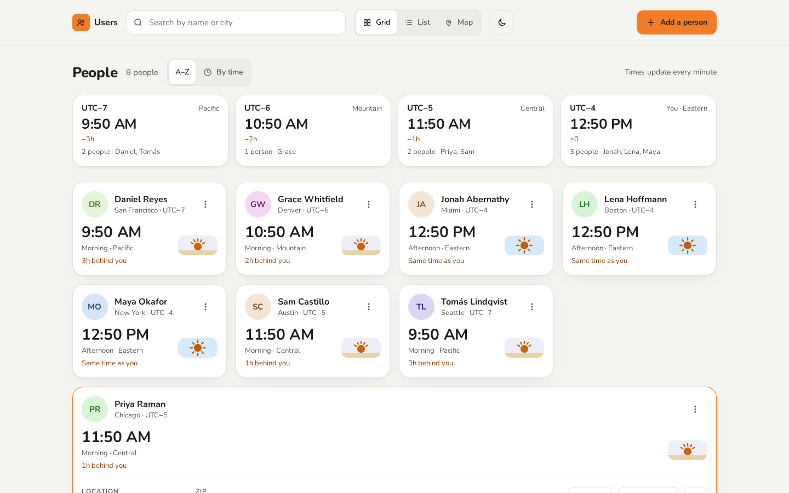

# User Management

Cards for a distributed team, each with the person's local time, grouped by UTC offset. Add someone with a name and a US zip; the city and offset are looked up for you.

[Live app](https://user-management-plum-six.vercel.app) · [Storybook](https://user-management-plum-six.vercel.app/storybook/) · [Figma](https://www.figma.com/design/Tu8Kz1qqdVWAczefkHzlpE)



## Run

Needs Node 24 and Yarn 1.

```sh
yarn install
yarn dev     # API on :8080, app on http://localhost:5173
yarn seed    # optional: adds a sample team
```

It runs offline by default with a built-in table of sample zips. For real lookups, copy `.env.example` to `.env` and set `LOCATION_PROVIDER=openweathermap` and `OPENWEATHER_API_KEY`.

## Layout

```
server/   Express API in TypeScript
  src/core/        users service and the ports it needs; no HTTP or vendors
  src/providers/   zip lookup plugins (sample, openweathermap, google)
  src/storage/     storage plugins (json-file, memory, upstash-redis)
  src/compose.ts   picks plugins from the environment
  test/            test helpers and recorded API responses
client/   React app; components and props match the Figma file
design/   tokens.css generated from Figma, plus the design sources
e2e/      Playwright tests
shared/   the US zip list both sides use
api/      Vercel entry point
```

## Develop

```sh
yarn test        # unit tests and the Figma token check
yarn typecheck
yarn e2e         # Playwright; run `yarn workspace user-management-e2e playwright install chromium` once
yarn storybook   # every component state on :6006
```

Design changes start in Figma: update the variable there, then `design/tokens.css` (`yarn test` fails if they drift). Pushes to `main` run CI and deploy to Vercel.
